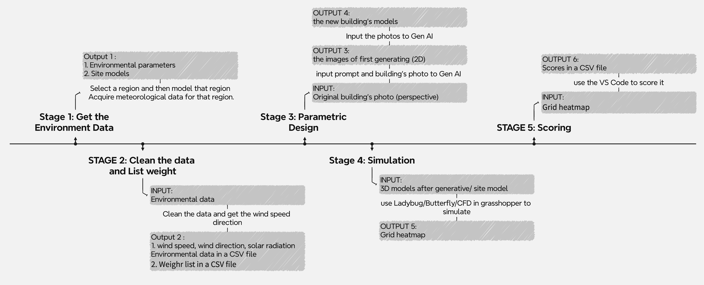
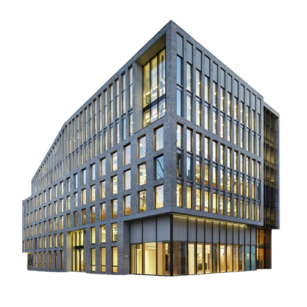

# 用生成式 AI 做建筑形态优化

如果把环境数据和生成式 AI 连起来，模型能不能根据一个连续的数值，产生可以进入风环境和热舒适分析的建筑形态。

最后搭出来的流程是：环境数据 → 图像编辑 → 2D 转 3D → 风和太阳辐射模拟 → UTCI 热舒适评分。



## 测试了什么

设置了四组对照：

1. Stable Diffusion
2. Stable Diffusion + LoRA
3. Flux-2
4. Flux-2 + LoRA

实验中固定输入图、种子、提示词、denoise、CFG、步数、采样器和调度器，只改变模型或控制方式。训练并配置了一个控制建筑圆角变化的 Concept Slider LoRA，测试的 scale 从 0.0 到 1.3。

输入建筑：



## 2D 转 3D 和模拟

先比较了 Tripo 单视图、Tripo 多视图和 ByteDance 单视图三种路线，再把生成的模型放进 Rhino / Grasshopper，通过 Butterfly、Ladybug 和 UTCI 进行环境评价。

评分脚本读取 UTCI 热力图，并计算三个部分：

- 接近目标舒适值的程度：50%
- 过热区域比例：30%
- 空间变化是否平滑：20%

`assets/simulation-samples/` 中放了四张同一控制值下的模拟结果，`data/scores/` 中是四组实验的评分表。

## 结论

- Tripo 对 14 组输入都能完成技术转换，但部分模型会失真。
- ByteDance 在两类测试中的有效率分别是 57% 和 71%。
- Stable Diffusion + LoRA 能产生比较容易识别的方向性变化。
- 直接在提示词中输入数字，变化通常不够稳定。
- 生成式 AI 目前可以帮助探索形态趋势，但还不能直接替代参数化建模。

## 文件说明

- `workflows/comfyui/`：Stable Diffusion 有 LoRA / 无 LoRA 的 ComfyUI 工作流。
- `grasshopper/`：风、太阳辐射、UTCI 和自动化连接文件。
- `scripts/utci_scoring.py`：从热力图中提取数值并计算综合分数。
- `data/scores/`：四组实验的评分结果。
- `assets/`：流程图、输入图和少量模拟结果。

## 运行评分脚本

不同电脑导出的热力图位置可能不一样，所以需要先检查图例和数据区域的坐标。

```bash
pip install -r requirements.txt
python scripts/utci_scoring.py path/to/heatmaps output.csv
```

## 目前还不完整的地方

现在最大的限制是 2D 图像到可模拟 3D 模型之间不够稳定，而且不同生成模型对数值控制的理解也不一致。这个项目更像是一次可行性验证，而不是已经完成的设计工具。
